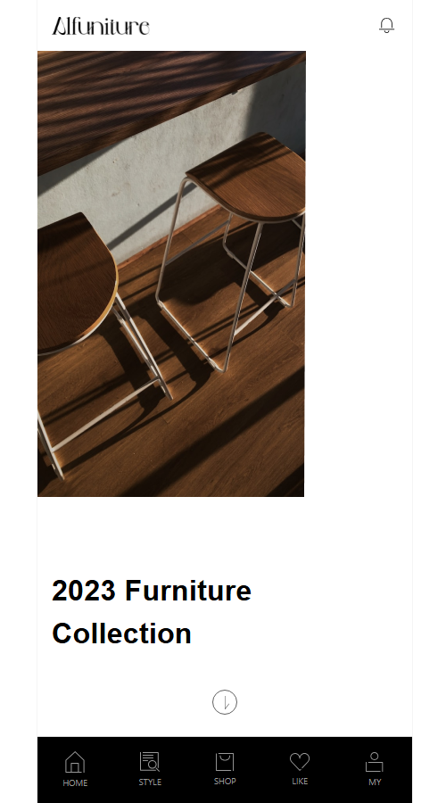
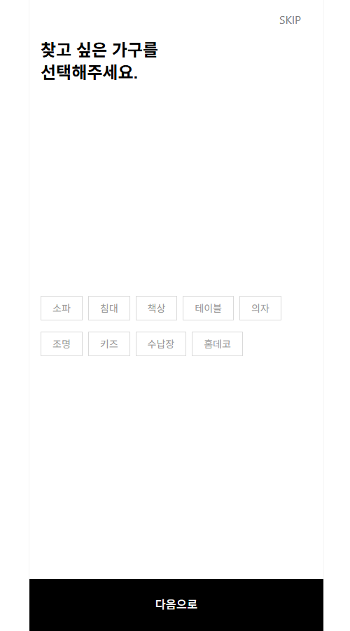
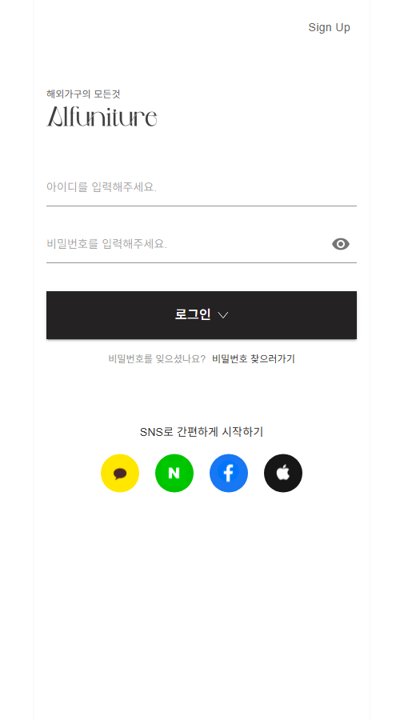
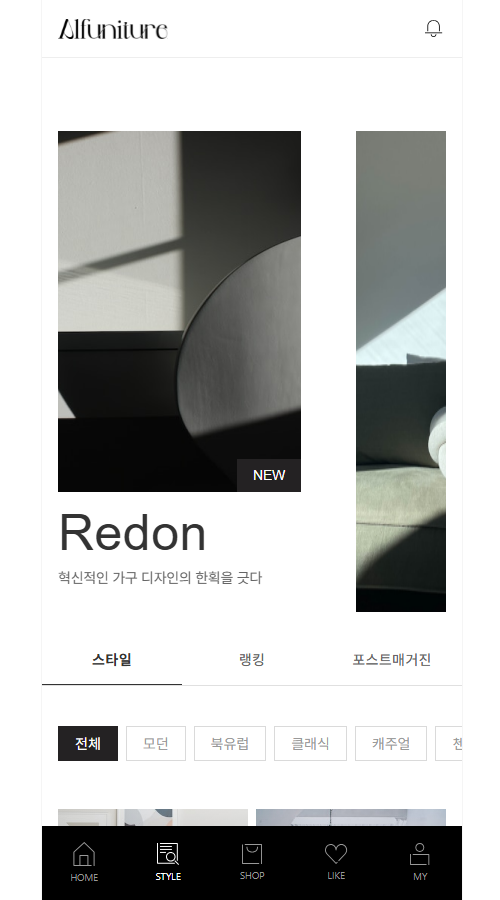
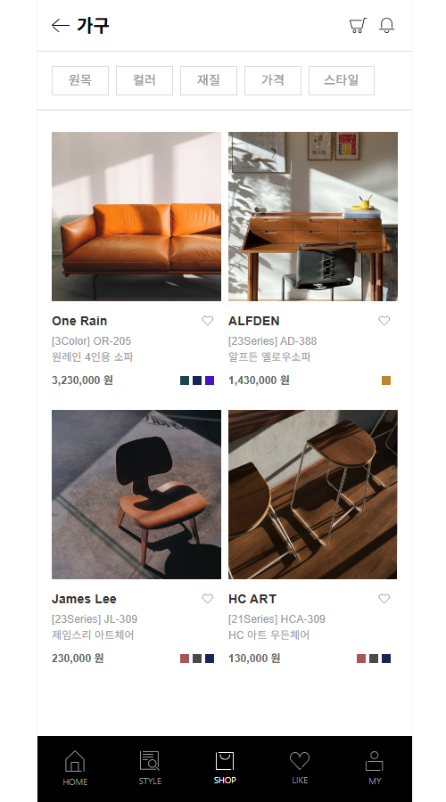
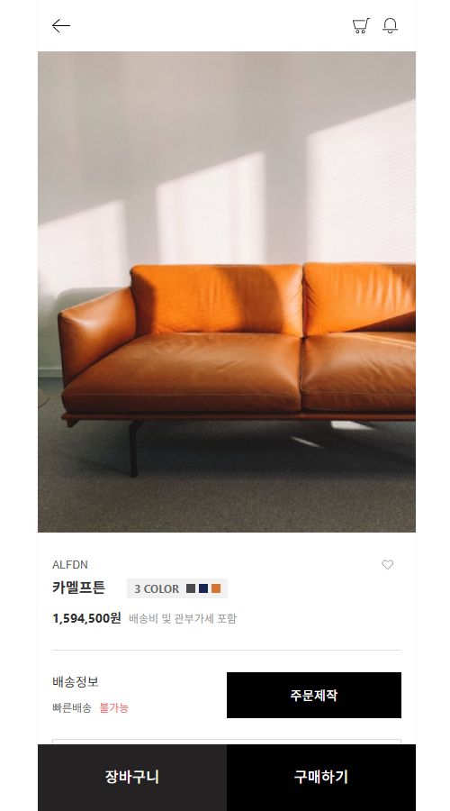
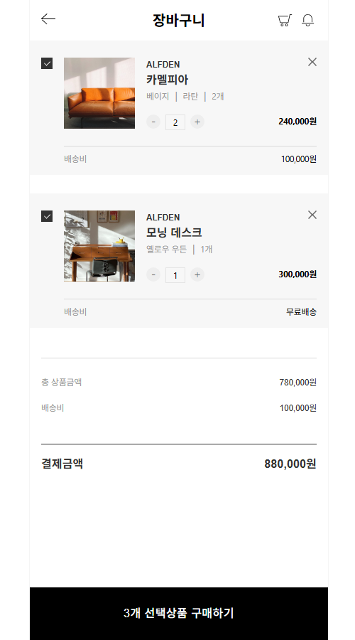
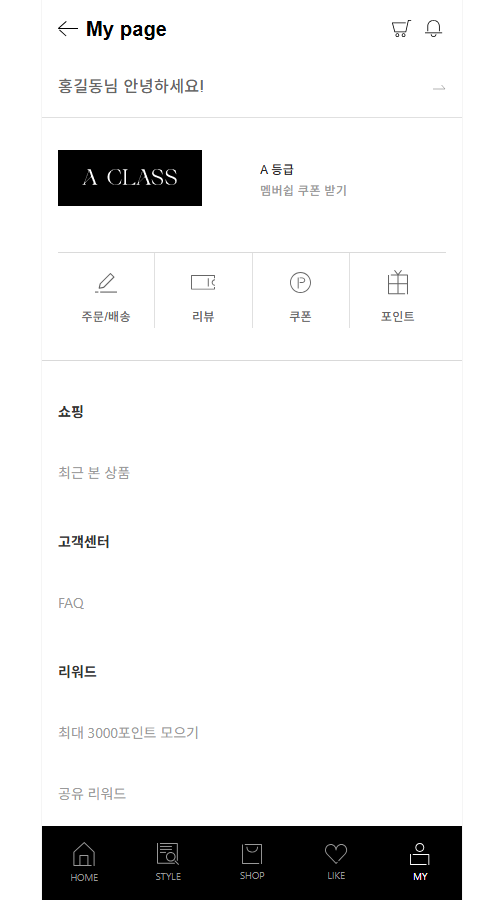

# 사이드 프로젝트 (프론트)

가구 쇼핑몰 Alfuniture 제작하기

### [👉 피그마](https://www.figma.com/file/LcaMSIPUt0lg9V0hPlSQ3s/SP_Design?type=design&node-id=0-1&mode=design&t=5C3CbLVHtugelje2-0)

### [👉 개선 사항 (중요도 순)](docs/IMPROVEMENTS.md)

---

## 현재 상태 기록 (기준선, 2026-11-24)

리팩터링·업그레이드 전에 현재 상태를 남겨 둔 기록입니다. 아래 수치는 모두 이 날짜에 로컬에서 직접 실행해서 얻은 값이고, 원본 로그는 [`docs/logs/`](docs/logs)에 있습니다. 이 결과로 정리한 개선 목록은 [`docs/IMPROVEMENTS.md`](docs/IMPROVEMENTS.md)에 있습니다.

### 1. 실행·빌드 환경

| 항목 | 값 |
| --- | --- |
| OS | Windows 11 Pro (10.0.26300) |
| Node.js / npm | v24.14.1 / 11.21.0 |
| 빌드 도구 | Create React App (`react-scripts` 5.0.1, webpack 5, Jest 27) |
| 언어 | TypeScript 4.9.5 (`strict: true`, `target: es5`) |
| UI | React 18.2, MUI 5.14 (+ Emotion), Swiper 10 |
| 라우팅 | react-router-dom 6.15 (`createBrowserRouter`) |
| 배포 설정 | Netlify SPA 리다이렉트 (`public/_redirects`, `src/netlify.toml`) |
| 코드 스타일 | Prettier 3.0 (`.prettierrc.js`: 세미콜론 없음, 작은따옴표, 120자) |

```bash
npm ci          # package-lock.json 기준 설치
npm start       # 개발 서버 http://localhost:3000
npm run build   # build/ 에 프로덕션 빌드
npm test        # Jest (현재 실패, 아래 참고)
npm run optimize-images   # 이미지 추가·교체 시: assets-original/images → src/assets/images 에 WebP 생성
```

설치할 때 나오는 메시지:
- `npm audit`: 취약점 76개 (critical 6 · high 37 · moderate 19 · low 14). 대부분 `react-scripts` 5의 하위 의존성입니다. → [`docs/logs/npm-audit.json`](docs/logs/npm-audit.json)
- `core-js`, `core-js-pure`의 설치 후 스크립트는 npm 11의 허용 목록에 없어서 실행되지 않습니다. 후원 안내 문구만 출력하는 스크립트라 동작에는 영향이 없습니다.
- `babel-preset-react-app`이 `@babel/plugin-proposal-private-property-in-object`를 의존성에 선언하지 않았다는 경고가 나옵니다. 지금은 동작하지만 언제든 깨질 수 있습니다.
- 개발 서버를 켜면 `fs.F_OK`, `onAfterSetupMiddleware` 등 deprecation 경고가 나옵니다. Node 24와 CRA 5 조합에서 생기는 것으로 동작에는 영향이 없습니다.

### 2. 구조

```
public/
  _redirects            Netlify SPA 리다이렉트
  videos/               릴스용 mp4 3개 (총 153MB)
src/
  App.tsx               라우터 정의 (약 35개 경로, 모두 Layout 하위)
  data/index.tsx        목업 데이터 (1,759줄, 상품·브랜드·리뷰 등)
  assets/images/        이미지 193개 (44MB) → 2026-11-24 WebP로 변환해 1.5MB (아래 참고)
  components/           공통 컴포넌트 (Box, Typography, Tabs, NavigationBar, title/*, product/*)
  pages/
    home/ onboarding/ auth/ shop/ style/ postmagazine/
    like/ cart/ order/ mypage/ notification/ Guide.tsx
  styles/               Emotion 스타일 객체 (buttons, checkbox, modal 등)
```

- 모바일 전용 레이아웃입니다. `Layout`이 최대 너비 420px 컨테이너 안에서 `<Outlet />`을 렌더링합니다.
- 소스 규모: `.ts/.tsx` 13,482줄. 이 중 `data/index.tsx`가 1,759줄입니다.
- 스타일은 MUI `sx` prop 654곳, 인라인 `style={{}}` 99곳, Emotion `styled`/`css` 파일로 나뉘어 있습니다.

### 3. 코드 한계 (알려진 문제)

**데이터·기능**
- 백엔드 연동이 없습니다. `fetch`·`axios`가 전혀 없고 모든 화면이 `src/data/index.tsx`의 하드코딩 목업을 씁니다.
- 전역 상태(Context, Redux 등)와 저장소(`localStorage`)도 쓰지 않습니다. 좋아요·장바구니·로그인 상태가 페이지를 이동하면 유지되지 않습니다.
- 라우트 파라미터가 없습니다. 예를 들어 `/shop/product_view`는 상품 ID 없이 한 화면만 보여 주고, 브랜드 스토리·에디터 픽·월간 포스트도 `/brand_story/aerobiey`처럼 경로가 고정돼 있습니다.

**라우팅**
- `/`(Home), `/shop`, `/mypage` 등이 같은 컴포넌트를 자식 경로에도 다시 등록합니다 (`/home`, `/shop/product_list` 등). 부모 컴포넌트에 `<Outlet />`이 없어서 자식 경로는 사실상 부모와 같은 화면입니다.
- 404 페이지와 에러 경계(`errorElement`)가 없습니다.

**의존성**
- 안 쓰는 패키지: `styled-components`, `react-material-ui-carousel`, `react-swipeable`. 소스에서 import하는 곳이 없습니다.
- `@emotion/css`와 `@emotion/styled`, MUI `sx`를 섞어 써서 스타일 방식이 통일돼 있지 않습니다.
- CRA는 더 이상 유지보수되지 않아 `react-scripts`를 올리는 것만으로는 보안 취약점을 해소할 수 없습니다. Vite 등으로 옮기는 것을 검토해야 합니다.

**품질**
- 테스트: 기본 템플릿 테스트(`App.test.tsx`) 1개뿐이고 이마저 실패합니다.
  1. Jest(CJS)가 ESM 전용인 `swiper/react`를 불러오지 못합니다 (`Cannot find module 'swiper/react'`).
  2. 테스트 내용 자체가 CRA 기본 문구 "learn react"를 찾는 것이라, 모듈 문제를 고쳐도 실패합니다.
- 타입: `any`가 22곳 있습니다.
- 접근성: `alt=""`인 이미지가 34개입니다. `index.html`이 `lang="en"`이고 `<title>`이 "React App"으로 남아 있습니다.
- `index.tsx`의 `reportWebVitals()`에 콜백이 없어서 측정값이 아무 데도 기록되지 않습니다.

**에셋·성능**
- 원본 이미지를 압축하지 않고 그대로 씁니다. 필터 아이콘(`filterIcon/wood_*.png`, `texture_*.png`)은 작게 표시되는데도 파일 하나가 0.6~6MB입니다. 상위 3개: `wood_etc.png` 6.0MB, `wood_maple.png` 5.6MB, `wood_walnut.png` 4.4MB.
- `public/videos/*.mp4` 3개가 총 153MB (78MB / 55MB / 27MB)이고 저장소에 직접 들어 있습니다.
- 코드 분할이 없습니다. 모든 페이지가 `main.js` 한 파일에 들어갑니다 (`React.lazy` 미사용).

### 4. 성능·품질 기준선

| 지표 | 값 | 로그 |
| --- | --- | --- |
| `npm run build` | 성공, 107초 (경고 있음) | [`build.log`](docs/logs/build.log) |
| JS 번들 `main.js` | 1,068 KB (gzip 387.85 KB) | 〃 |
| CSS 번들 | gzip 3.79 KB | 〃 |
| 추가 청크 | gzip 1.78 KB (`web-vitals`) | 〃 |
| 빌드 산출물 전체 | 201 MB (이미지 `static/media` 44MB·155개 + 영상 153MB) | |
| `tsc --noEmit` | 오류 0개, 16.7초 | [`tsc.log`](docs/logs/tsc.log) |
| ESLint (`react-app` 설정) | 오류 0 · 경고 55 | [`eslint.log`](docs/logs/eslint.log) |
| └ `no-unused-vars` | 35 | |
| └ `react-hooks/exhaustive-deps` | 6 | |
| └ `no-empty-pattern` | 6 | |
| └ `eqeqeq` | 6 | |
| Jest | 스위트 1개 실패, 테스트 0개 실행 | [`test.log`](docs/logs/test.log) |
| `npm audit` | 76개 (C6 · H37 · M19 · L14) | [`npm-audit.json`](docs/logs/npm-audit.json) |

#### Lighthouse (홈 `/`)

**측정 조건:** Lighthouse 13.5.0, Chrome 157 DevTools, 모바일 (Moto G Power 에뮬레이션), Slow 4G 시뮬레이션 (RTT 150ms, 약 1.6Mbps, CPU 4배 감속), 첫 페이지 로드. 프로덕션 빌드를 `serve`로 띄워 측정했습니다 (gzip 압축 적용). 2026-11-24 19:53 KST. 원본: [`docs/logs/lighthouse_summary_before.json`](docs/logs/lighthouse_summary_before.json)

| 성능 | 접근성 | 권장사항 | SEO |
| :-: | :-: | :-: | :-: |
| **75** | **60** | 96 | 92 |

| 지표 | 값 | Google "양호" 기준 | 판정 |
| --- | --: | --: | :-: |
| First Contentful Paint | 0.8초 | ≤ 1.8초 | ✅ |
| **Largest Contentful Paint** | **5.1초** | ≤ 2.5초 | ❌ |
| Total Blocking Time | 300ms | ≤ 200ms | ⚠️ |
| Cumulative Layout Shift | 0.027 | ≤ 0.1 | ✅ |
| Speed Index | 1.6초 | ≤ 3.4초 | ✅ |
| Time to Interactive | 5.2초 | ≤ 3.8초 | ⚠️ |
| Max Potential FID | 220ms | ≤ 130ms | ⚠️ |
| 전송량 합계 | 881 KiB | | |
| 메인스레드 작업 | 1.0초 (스크립트 실행 368ms, 스타일·레이아웃 252ms, 파싱·컴파일 63ms) | | |
| JS 실행 시간 (`main.js`) | 692ms | | |

**주요 진단**
- **LCP 요소는 홈 첫 슬라이드 이미지 `chair04.png`** 입니다. 250KB이고, Lighthouse는 이 중 225KB를 줄일 수 있다고 봅니다. ``에 `width`/`height`가 없고 표시 크기에 비해 해상도도 맞지 않습니다 (`image-size-responsive`). `alt="chair01"`인데 실제 파일은 `chair04`입니다.
- **이미지 전달 개선으로 433 KiB를 줄일 수 있습니다.** `chair04` 225KB, `ranking_item06` 91KB, `ranking_item01` 50KB, `james_lee` 44KB 등입니다. 크기를 지정하지 않은 이미지가 11개입니다.
- **안 쓰는 JS가 183 KiB입니다.** `main.js`(전송 368KB) 중 약 절반이 홈에서 실행되지 않습니다. 코드 분할이 없기 때문입니다.
- **긴 작업 3개:** `main.js` 220ms, 177ms, 원인 불명 113ms
- **렌더링 차단 요청:** `main.css`로 160ms를 줄일 수 있습니다.
- **캐시:** 876 KiB를 줄일 수 있습니다. JS·CSS·이미지에 캐시 수명 헤더가 없습니다. 측정에 쓴 로컬 `serve` 설정 때문이므로 배포 환경(Netlify)에서 다시 확인해야 합니다.

**접근성 (60점) 실패 항목**
- `button-name`: 이름이 없는 아이콘 버튼 3개 (MUI `IconButton`)
- `link-name`: 텍스트가 없는 링크 2개 (`/home` 로고 링크, `/notification` 알림 아이콘)
- `image-alt`: `alt`가 없는 이미지 1개 (`james_lee.png`, `src/pages/home/Home.tsx:83`)
- `color-contrast`: 대비가 부족한 텍스트 9개. 흰 배경의 회색 `#999999`로 대비율 2.84이고, 기준은 4.5 이상입니다.
- `landmark-one-main`: `<main>` 랜드마크가 없습니다.

**기타:** 권장사항 감점은 "저해상도 이미지 제공" 때문입니다. SEO 감점은 `image-alt` 때문입니다.

#### Lighthouse 재측정: 7번 이미지 최적화 후

**측정 조건:** 위와 같습니다 (Lighthouse 13.5.0, 모바일, Slow 4G 시뮬레이션). 2026-11-24 20:44 KST. 측정 주소는 `/home`이고 `/`와 같은 홈 화면입니다. 원본: [`docs/logs/lighthouse_summary_after.json`](docs/logs/lighthouse_summary_after.json) · 변경 내용: [IMPROVEMENTS.md 7번](docs/IMPROVEMENTS.md#7-결과-2026-11-24)

| 점수 | 전 | 후 |
| --- | :-: | :-: |
| **성능** | 75 | **94** |
| 접근성 | 60 | 60 |
| 권장사항 | 96 | 96 |
| SEO | 92 | 92 |

| 지표 | 전 | 후 | 양호 기준 | 판정 |
| --- | --: | --: | --: | :-: |
| First Contentful Paint | 0.8초 | 0.8초 | ≤ 1.8초 | ✅ |
| **Largest Contentful Paint** | 5.1초 | **2.8초** | ≤ 2.5초 | ⚠️ (0.3초 초과) |
| **Total Blocking Time** | 300ms | **150ms** | ≤ 200ms | ✅ |
| Cumulative Layout Shift | 0.027 | **0** | ≤ 0.1 | ✅ |
| Speed Index | 1.6초 | 1.5초 | ≤ 3.4초 | ✅ |
| **Time to Interactive** | 5.2초 | **2.9초** | ≤ 3.8초 | ✅ |
| Max Potential FID | 220ms | 230ms | ≤ 130ms | ⚠️ |
| **전송량 합계** | 881 KiB | **311 KiB** (-65%) | | |
| └ `main.js` | 368 KiB | 262 KiB | | |
| └ LCP 이미지 `chair04` | 250 KiB | 16 KiB | | |
| 이미지 전달 개선 가능량 | 433 KiB | **0** (경고 없음) | | |
| 안 쓰는 JS | 183 KiB | 150 KiB | | |
| JS 실행 시간 (`main.js`) | 692ms | 716ms | | |

**해석**
- **이미지 문제는 해결됐습니다.** LCP 이미지가 250KB에서 16KB로 줄었고, `fetchpriority="high"`로 먼저 받습니다. "이미지 전달 개선" 경고가 사라졌고 레이아웃 밀림(CLS)도 0이 됐습니다.
- **이제 남은 병목은 JS입니다.** 전송량 311KB 중 `main.js`가 262KB(84%)이고 그중 150KB는 홈에서 쓰지 않습니다. 긴 작업 2개(230ms, 167ms)도 모두 `main.js`입니다. LCP 이미지는 JS가 실행되고 나서야 요청이 시작되므로(`lcp-discovery-insight`), LCP 2.8초를 2.5초 아래로 내리려면 **8번 코드 분할**이 필요합니다.
- **Max Potential FID 230ms**도 `main.js`의 긴 작업 때문이라 8번에서 함께 개선될 것으로 봅니다.
- **그대로인 항목**
  - 접근성(60): 10번 작업 대상입니다.
  - 권장사항의 "저해상도 이미지": `chair04` 원본이 301×500이라 남았습니다.
  - 크기를 지정하지 않은 이미지 10개: 홈 슬라이드와 랭킹 이미지입니다. 둘 다 크기가 고정된 상자 안에 있어서 CLS에는 영향이 없습니다.
  - 캐시 경고(306 KiB): 로컬 `serve` 설정 때문입니다.

#### Lighthouse 재측정: 8번 코드 분할 후

**측정 조건:** 위와 같습니다 (Lighthouse 13.5.0, 모바일, Slow 4G 시뮬레이션, `/home`). 2026-11-24 21:44 KST. 원본: [`docs/logs/lighthouse_summary_after_lazy_router.json`](docs/logs/lighthouse_summary_after_lazy_router.json) · 변경 내용: [IMPROVEMENTS.md 8번](docs/IMPROVEMENTS.md#8-결과-2026-11-24)

| 점수 | 기준선 | 7번 후 | 8번 후 |
| --- | :-: | :-: | :-: |
| **성능** | 75 | 94 | **97** |
| 접근성 | 60 | 60 | 60 |
| 권장사항 | 96 | 96 | 96 |
| SEO | 92 | 92 | 92 |

| 지표 | 기준선 | 7번 후 | 8번 후 | 양호 기준 | 판정 |
| --- | --: | --: | --: | --: | :-: |
| First Contentful Paint | 0.8초 | 0.8초 | 0.8초 | ≤ 1.8초 | ✅ |
| **Largest Contentful Paint** | 5.1초 | 2.8초 | **2.45초** | ≤ 2.5초 | ✅ |
| Total Blocking Time | 300ms | 150ms | **120ms** | ≤ 200ms | ✅ |
| Cumulative Layout Shift | 0.027 | 0 | 0 | ≤ 0.1 | ✅ |
| Speed Index | 1.6초 | 1.5초 | **1.3초** | ≤ 3.4초 | ✅ |
| Time to Interactive | 5.2초 | 2.9초 | **2.6초** | ≤ 3.8초 | ✅ |
| Max Potential FID | 220ms | 230ms | 220ms | ≤ 130ms | ⚠️ |
| 전송량 합계 | 881 KiB | 311 KiB | **236 KiB** | | |
| └ `main.js` | 368 KiB | 262 KiB | **187 KiB** | | |
| 안 쓰는 JS | 183 KiB | 150 KiB | **71 KiB** | | |
| JS 실행 시간 (`main.js`) | 692ms | 716ms | **641ms** | | |
| 메인스레드 작업 | 1.0초 | 1.0초 | **0.8초** | | |
| 긴 작업 | 3개 (220·177·113ms) | 3개 (230·167·66ms) | **2개** (221·113ms) | | |

**해석**
- **Core Web Vitals 3개(LCP·TBT·CLS)가 모두 "양호"에 들어왔습니다.** 기준선 대비 성능 점수 +22, LCP -52%, 전송량 -73%입니다.
- **LCP 2.45초는 기준(2.5초) 바로 아래라 여유가 거의 없습니다.** 홈에 JS나 이미지를 더 넣으면 다시 넘을 수 있으니, 기능을 추가할 때마다 이 수치를 확인하세요.
- **남은 감점 요인**
  - **Max Potential FID 220ms:** `main.js`의 첫 긴 작업(221ms) 때문입니다. React, MUI, Emotion 초기화와 홈 렌더링이 원인이며, 목업 데이터를 분리하거나 홈 아래쪽 섹션을 늦게 렌더링하면 줄일 수 있습니다.
  - **안 쓰는 JS 71 KiB:** 메인 번들에 남은 공통 라이브러리와 목업 데이터입니다.
  - **렌더링 차단 CSS 160ms:** `main.css` 3.8KB입니다. 크기가 작아서 우선순위는 낮습니다.
  - **접근성 60, 저해상도 이미지, 크기 미지정 이미지 10개, 캐시 경고:** 7번 후와 같습니다.

#### Lighthouse 재측정: 10번 접근성 수정 후

**측정 조건:** 위와 같습니다 (Lighthouse 13.5.0, 모바일, Slow 4G 시뮬레이션, `/home`). 2026-11-24 22:45 KST. 원본: [`docs/logs/lighthouse_summary_after_labeling.json`](docs/logs/lighthouse_summary_after_labeling.json) · 변경 내용: [IMPROVEMENTS.md 10번](docs/IMPROVEMENTS.md#10-결과-2026-11-24)

| 점수 | 기준선 | 7번 후 | 8번 후 | 10번 후 |
| --- | :-: | :-: | :-: | :-: |
| 성능 | 75 | 94 | 97 | **97** |
| **접근성** | 60 | 60 | 60 | **100** |
| 권장사항 | 96 | 96 | 96 | 96 |
| **SEO** | 92 | 92 | 92 | **100** |

| 지표 | 8번 후 | 10번 후 |
| --- | --: | --: |
| Largest Contentful Paint | 2.45초 | 2.45초 |
| Total Blocking Time | 120ms | 120ms |
| Cumulative Layout Shift | 0 | 0 |
| 전송량 합계 | 236 KiB | 236 KiB |

**해석**
- **접근성 60 → 100:** 지적됐던 5개 항목이 모두 통과했습니다.
  - `button-name`, `link-name`, `image-alt`, `color-contrast`(9곳), `landmark-one-main`
- **SEO 92 → 100:** 감점 원인이던 `image-alt`가 해결됐습니다.
- **성능 지표는 그대로입니다.** 라벨과 색만 바꿨기 때문입니다 (`main.js` +0.1KB). LCP 요소의 `alt`가 의미 있는 문구로 바뀐 것도 확인했습니다.
- **남은 감점은 권장사항(96)의 "저해상도 이미지" 1건뿐입니다.** `chair04` 원본이 301×500이라 더 큰 원본이 있어야 해결됩니다.
- **한계:** Lighthouse는 홈 화면만 측정합니다. 다른 페이지에는 연한 색 토큰(`#BDBDBD`, `#DADADA` 등)의 저대비 글자가 남아 있습니다 → [IMPROVEMENTS.md 10번 남은 일](docs/IMPROVEMENTS.md#10-결과-2026-11-24)

> **아래 4-1 직접 측정과 수치가 다른 이유:** Lighthouse는 실제로 느린 네트워크에서 불러오지 않고, 빠르게 불러온 뒤 Slow 4G였을 때를 계산으로 추정합니다. 측정 서버도 JS를 gzip으로 압축했습니다 (368KB). 4-1은 실제로 네트워크와 CPU를 느리게 만들었고, 압축 없이 1.0MB를 받았습니다. 그래서 4-1은 최악에 가까운 경우로 보면 됩니다. 앞으로 비교하는 기준선은 Lighthouse 수치를 쓰세요.

### 4-1. 탐색·목록 체감 속도

**측정 조건:** 프로덕션 빌드, 헤드리스 Chrome + DevTools Protocol, 모바일 412×823 (DPR 1.75), **CPU 4배 감속, Slow 4G (RTT 150ms, 1.6Mbps)**, 캐시 끔. Lighthouse 모바일 기본 조건과 같습니다. 원본: [`docs/logs/perf-baseline.json`](docs/logs/perf-baseline.json)

**페이지 로드**

| 경로 | FCP | LCP | LCP 요소 | TBT | CLS | JS 실행 | 메인스레드 작업 | 이미지 (지연 로딩 / 전체 / 첫 화면 밖) |
| --- | --: | --: | --- | --: | --: | --: | --: | --- |
| `/` | 7.4초 | **10.0초** | `chair04.png` | 1,502ms | 0.03 | 1,065ms | 2,112ms | 0 / 17 / 13 |
| `/shop` | 7.1초 | **10.8초** | `sofa01.png` | 1,344ms | 0 | 1,002ms | 2,114ms | 0 / 4 / 0 |
| `/shop/product_view` | 7.2초 | 9.0초 | `sofa01.png` | 1,399ms | **0.54** | 875ms | 1,907ms | 0 / 10 / 5 |
| `/style` | 6.8초 | 8.5초 | `style_banner03.png` | 1,049ms | 0 | 752ms | 1,781ms | 0 / 10 / 6 |
| `/cart` | 6.4초 | 8.6초 | `sofa01.png` | 518ms | 0 | 709ms | 1,567ms | 0 / 2 / 0 |

참고 기준 (Google "양호"): LCP ≤ 2.5초, TBT ≤ 200ms, CLS ≤ 0.1. **5개 페이지 모두 LCP와 TBT가 기준을 넘습니다.**

- **초기 번들이 첫 화면을 늦춥니다.** 코드 분할이 없어서 모든 경로가 같은 `main.js`(1,068KB, gzip 388KB)를 받아서 파싱·실행해야 첫 화면이 그려집니다. 측정에 쓴 정적 서버는 gzip 압축을 하지 않아서 1.0MB를 그대로 받았습니다. 그래서 어느 페이지든 FCP가 6.4~7.4초로 비슷합니다. Netlify처럼 압축해서 내려주면 이 시간은 줄어듭니다.
- **이미지 지연 로딩이 전혀 없습니다.** 소스 전체에 `loading="lazy"`가 한 곳도 없습니다. 홈 화면은 이미지 17개 중 13개가 첫 화면 밖에 있는데도 처음부터 모두 받습니다.
- **이미지 크기를 지정하지 않았습니다.** ``에 `width`/`height`가 없어서 이미지가 로드되면서 레이아웃이 밀립니다. 상품 상세의 CLS 0.54가 이 때문으로 보입니다.
- **이미지 최적화가 없습니다.** WebP/AVIF, `srcset`, LCP 이미지 `preload`를 쓰지 않습니다. 장바구니 썸네일(100px)에는 표시 크기의 3.5배가 넘는 원본 이미지를 받습니다.

**필터 화면 반응 속도 (`/shop`)**

| 필터 | 열림 (클릭 → 화면 갱신) | 항목 수 | 아이콘 이미지 로드 | "제품 보러가기" 적용 | 적용 전 → 후 상품 수 |
| --- | --: | --: | --- | --: | --- |
| 원목 | 355ms | 8 | **60초 안에 끝나지 않음** (아이콘 8개 25.8MB) | 106ms | 4 → 4 |
| 컬러 | 175ms | 12 | 즉시 | 72ms | 4 → 4 |
| 재질 | 131ms | 6 | **60초 안에 끝나지 않음** (아이콘 5개 9.0MB) | 78ms | 4 → 4 |
| 가격 | 115ms | 입력창 2개 | 해당 없음 | 85ms | 4 → 4 |
| 스타일 | 132ms | 8 | 1.5초 (0.3MB) | 78ms | 4 → 4 |

- **필터가 목록에 실제로 적용되지 않습니다.** 선택한 옵션은 `filterOptions` 상태에 저장되고 버튼 이름에만 표시됩니다 (`src/pages/shop/ProductList.tsx`). 목록은 항상 `shopProductData` 전체를 그려서 적용 전후 상품 수가 같습니다. 가격 입력값은 상태로 연결되어 있지도 않습니다.
- **정렬과 검색 UI가 없습니다.** 상품 목록에 정렬·검색 기능이 없어서 측정하지 못했습니다. 찜 목록의 "품절 제외" 체크박스와 정렬 버튼도 아무 동작에 연결되어 있지 않습니다.
- 첫 번째 필터(원목)는 MUI Drawer를 처음 렌더링하는 비용 때문에 355ms가 걸립니다. 나머지는 100~200ms입니다. `useMemo`, `useCallback`, `React.memo`는 소스에서 한 번도 쓰지 않습니다.
- 원목·재질 필터는 약 40px로 표시되는 아이콘에 0.6~6MB짜리 원본 PNG를 씁니다. 모바일 네트워크에서는 사실상 아이콘이 보이지 않습니다.

### 4-2. 상태 동기화 안정성

| 항목 | 현재 상태 | 근거 |
| --- | --- | --- |
| 서버 상태 | **없음.** API 호출이 전혀 없고 모든 데이터가 `src/data/index.tsx` 목업입니다. 그래서 서버와 UI 사이의 불일치는 아직 검증할 수 없습니다. | `fetch`/`axios` 0건 |
| 로컬/전역 상태 | 장바구니·찜·옵션 선택이 각 페이지의 `useState`에만 있습니다. Context·스토어·`localStorage`가 없어서 페이지를 이동하거나 새로 고치면 초기화됩니다. | |
| 상품 상세 → 장바구니 | "장바구니" 모달에서 "확인"을 누르면 모달만 닫히고 장바구니에 담기지 않습니다 (`handleAddCart`). 장바구니 화면은 항상 같은 목업 2개를 보여 줍니다. | `src/pages/shop/ProductView/index.tsx` |
| 장바구니 수량 변경 | `[...data]`로 배열만 복사하고 항목 객체는 그대로 고칩니다 (`updatedData[index].count += 1`). 모듈 전역인 `cartProductData`가 함께 바뀌어서, 장바구니를 나갔다 다시 들어오면 바뀐 수량이 남아 있습니다. 수량 입력창은 `onChange` 없이 `value`만 지정되어 있어 직접 입력할 수 없습니다. 최대 수량·재고 확인이 없습니다. | `src/pages/cart/index.tsx` |
| 장바구니 항목 삭제 | 선택 상태를 **배열 인덱스**로 관리합니다. 삭제할 때 `selectedProducts.splice(index, 1)`로 값이 아니라 위치를 지우고, 남은 인덱스도 앞으로 당기지 않습니다. 그래서 삭제 후 다른 상품의 체크 상태와 결제 금액이 어긋날 수 있습니다. 리스트 `key`도 `index`입니다. | 〃 |
| 구매 버튼 문구 | "N개 선택상품"의 N이 상품 종류 수가 아니라 **수량 합계**입니다. 예: 상품 2종(수량 2+1) → "3개". | 〃 |
| 옵션 선택 완료 여부 | `complete[0] = true; setComplete(complete)`처럼 같은 배열을 고쳐서 다시 넣습니다. React가 변경을 감지하지 못해 다시 렌더링하지 않고, 자식은 props인 `selectedColor`에 직접 값을 넣습니다. 버튼을 누르는 시점에는 고쳐진 배열을 읽어서 우연히 동작합니다. 옵션 태그의 X 아이콘에는 클릭 핸들러가 없습니다. | `src/pages/shop/ProductView/OrderSelector.tsx` |
| 품절·가격 변동 | **처리 없음.** 재고나 품절 필드가 데이터에 없습니다. 상세 가격(`1,594,500원`)과 결제 버튼 금액(`1,435,050원 결제하기`)이 하드코딩되어 있어 옵션·수량·쿠폰에 따라 바뀌지 않습니다. `applyCoupon()`은 비어 있고 `finalAmount`는 쓰이지 않습니다. | `ProductView/index.tsx`, `src/pages/order/Order.tsx` |

### 4-3. 예외 및 네트워크 대응

| 항목 | 현재 상태 |
| --- | --- |
| API 실패·타임아웃 | **처리 없음.** API 호출 자체가 없고 `try/catch`, `AbortController`, 재시도 로직이 없습니다. |
| 렌더링 오류 | 에러 경계(`ErrorBoundary`)와 라우터 `errorElement`, 404 경로가 없습니다. 오류가 나면 흰 화면이 됩니다. |
| 로딩 상태 | 스켈레톤과 스피너가 없습니다. `CircularProgress`는 온보딩의 연출용 화면(`LoadingCuration`)에서만 씁니다. 이미지가 늦게 오면 빈 영역이 보입니다 (4-1 원목 필터 참고). |
| 빈 목록 | 장바구니, 쿠폰, 주문 내역, 리뷰, 리뷰 목록, 알림 6곳에 `NoData` 컴포넌트가 있습니다. **상품 목록(`/shop`)과 필터 결과에는 빈 목록 처리가 없습니다.** |
| 만료 데이터 | 쿠폰 D-day를 `endDate - 오늘`로 계산하지만 만료 여부는 검사하지 않습니다. 목업 쿠폰은 2023년에 만료되어 음수 값이 나오고, 화면에 `"D-" + dDay`로 그대로 표시되어 `D--1100`처럼 보입니다 (2026-11-24 기준). 만료된 쿠폰도 목록에 남고 주문에서 고를 수 있습니다. |
| 중복 요청 방지 | **없음.** "결제하기"(`handleCompleteOrder`)는 바로 `navigate("/")`만 하고, "장바구니 담기" 확인은 모달만 닫습니다. 처리 중 버튼을 비활성화하거나 요청 키로 중복을 막는 로직이 없어서, 실제 API를 연결하면 연속 클릭 시 결제나 담기가 여러 번 실행될 수 있습니다. |
| 입력 검증 | 주문서는 필수 값이 비어 있으면 결제 버튼을 비활성화합니다. 휴대폰 번호는 정규식으로 검사하는데, `else` 분기에서 `setPhoneError`를 연달아 호출해 마지막 호출만 적용됩니다. |

### 5. 스크린샷

프로덕션 빌드를 정적 서버로 띄우고 헤드리스 Chrome으로 찍었습니다 (창 크기 500×900). 앱 본문은 가운데 420px 영역입니다. 원본: [`docs/screenshots/`](docs/screenshots)

| 홈 `/` | 온보딩 `/onboarding` | 로그인 `/auth/sign_in` | 스타일 `/style` |
| :-: | :-: | :-: | :-: |
|  |  |  |  |
| **상품 목록 `/shop`** | **상품 상세 `/shop/product_view`** | **장바구니 `/cart`** | **마이페이지 `/mypage`** |
|  |  |  |  |

### 6. 로그 파일

| 파일 | 내용 |
| --- | --- |
| [`docs/logs/build.log`](docs/logs/build.log) | `npm run build` 전체 출력 (ESLint 경고, 번들 크기, 소요 시간) |
| [`docs/logs/tsc.log`](docs/logs/tsc.log) | `npx tsc --noEmit` 결과와 소요 시간 |
| [`docs/logs/eslint.log`](docs/logs/eslint.log) | `npx eslint "src/**/*.{ts,tsx}" -f compact` |
| [`docs/logs/test.log`](docs/logs/test.log) | `CI=true react-scripts test --watchAll=false` |
| [`docs/logs/npm-audit.json`](docs/logs/npm-audit.json) | `npm audit --json` |
| [`docs/logs/perf-baseline.json`](docs/logs/perf-baseline.json) | 4-1 측정 원본 (경로별 로드 지표, 필터 상호작용) |
| [`docs/logs/lighthouse_summary_before.json`](docs/logs/lighthouse_summary_before.json) | Lighthouse 13.5.0 홈 화면 모바일 측정 결과 (기준선) |
| [`docs/logs/lighthouse_summary_after.json`](docs/logs/lighthouse_summary_after.json) | 같은 조건 재측정 (7번 이미지 최적화 후) |
| [`docs/logs/lighthouse_summary_after_lazy_router.json`](docs/logs/lighthouse_summary_after_lazy_router.json) | 같은 조건 재측정 (8번 코드 분할 후) |
| [`docs/logs/lighthouse_summary_after_labeling.json`](docs/logs/lighthouse_summary_after_labeling.json) | 같은 조건 재측정 (10번 접근성 수정 후) |
| [`docs/logs/perf-after-images.json`](docs/logs/perf-after-images.json) | 4-1과 같은 조건 재측정 (7번 이미지 최적화 후) |
| [`docs/logs/optimize-images.log`](docs/logs/optimize-images.log) | `npm run optimize-images` 파일별 변환 결과 |
| [`docs/logs/build-after-images.log`](docs/logs/build-after-images.log) | 7번 이후 `npm run build` 출력 |
| [`docs/logs/build-after-split.log`](docs/logs/build-after-split.log) | 8번 코드 분할 이후 `npm run build` 출력 (청크별 크기) |
| [`docs/logs/perf-after-split.json`](docs/logs/perf-after-split.json) | 4-1과 같은 조건 재측정 (8번 코드 분할 후) |
| [`docs/logs/build-after-a11y.log`](docs/logs/build-after-a11y.log) | 10번 접근성 수정 이후 `npm run build` 출력 |
| [`docs/logs/build-after-cart-store.log`](docs/logs/build-after-cart-store.log) | 1번 장바구니 스토어 이후 `npm run build` 출력 |
| [`docs/logs/cart-e2e.log`](docs/logs/cart-e2e.log) | 장바구니 흐름 브라우저 E2E 결과 |
| [`docs/logs/build-after-checkout.log`](docs/logs/build-after-checkout.log) | 3번 주문서 금액 계산 이후 `npm run build` 출력 |
| [`docs/logs/order-e2e.log`](docs/logs/order-e2e.log) | 장바구니 → 주문서 금액·쿠폰 계산 브라우저 E2E 33개 항목 결과 |
| [`docs/logs/a11y-audit-before.json`](docs/logs/a11y-audit-before.json) / [`a11y-audit-after.json`](docs/logs/a11y-audit-after.json) | 41개 경로 접근성 점검 (이름 없는 버튼·링크, alt, main, 저대비 글자) 전/후 |
